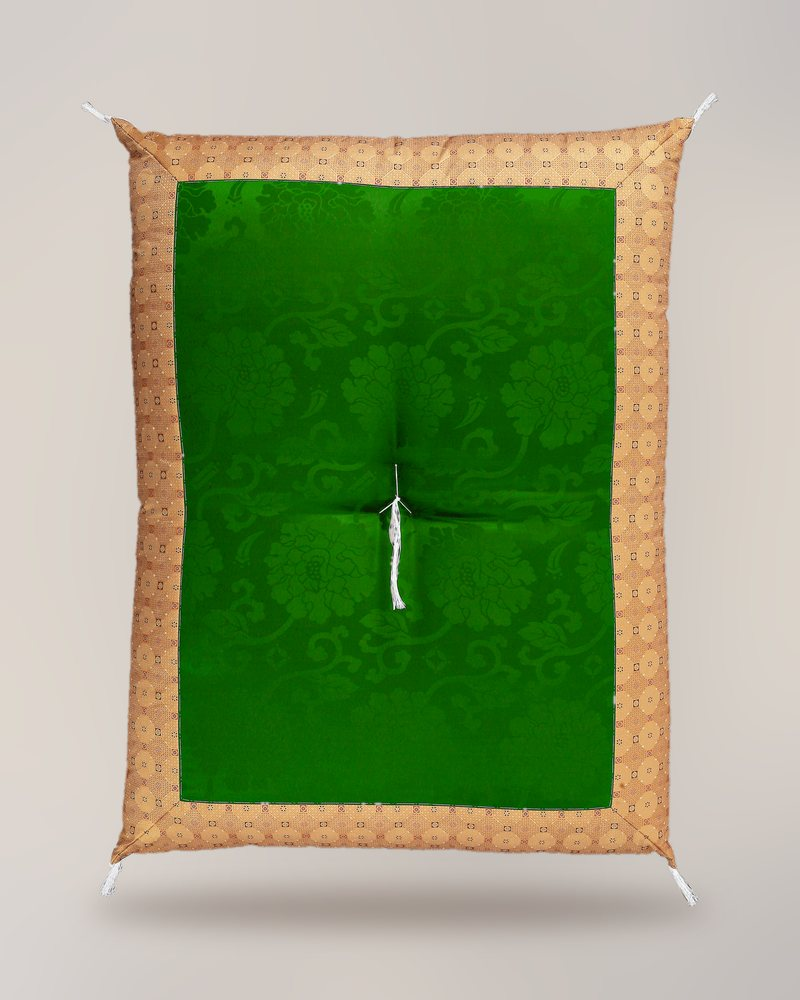

# Zen Center Practice Registry

A single static page that lists practice items the zen center is raising money for, in the style of a wedding registry. Open `index.html` in a browser to see it. There is no build step, framework or JavaScript.

## Files

| Path | What it is |
|---|---|
| `index.html` | The page. Each item is one `<article class="gift">` card. |
| `styles.css` | All styles. Brand colors and fonts are defined as variables at the top. |
| `fonts/` | Nexa Book (regular) and Nexa XBold (headings and prices). |
| `images/` | One photo per item, 800×1000 (4:5), already cut out onto a shared soft background. `background.jpg` is that background on its own, used behind placeholder cards. `placeholder-*.svg` are temporary images for items without a photo. |

## Editing items

Each card follows the same structure:

```html
<article class="gift">
  <div class="gift-photo has-photo fill"></div>
  <div class="gift-body">
    <h2 class="gift-name">Zaniku cushion</h2>
    <p class="gift-note">The cushion that rests on top of the bowing mat.</p>
    <div class="gift-foot">
      <div class="gift-price">$988.29<small>optional line, e.g. "$79 each · 25 needed"</small></div>
      <a class="gift-btn" href="mailto:...">Give this gift</a>
      <span class="gift-thanks">Given with thanks</span>
    </div>
  </div>
</article>
```

- **Items without a price** use `<div class="gift-price tbd">Price coming soon<small>Give any amount</small></div>`.
- **Items without a photo** drop the `has-photo fill` classes and point the `img` at a placeholder SVG.
- **New photos** look best at 4:5 on the same background. `images/background.jpg` can be reused for that.

## Marking an item as given

Add the class `purchased` to the card:

```html
<article class="gift purchased">
```

This greys out the photo and text, strikes through the price, hides the button and shows a red "Given with thanks" line. Remove the class to undo it. No item is marked as given right now.

## Donate buttons

Each "Give this gift" button is a `mailto:` link to info@zencare.org with the subject "Practice Registry: Interested in Donating {item name}". Swap the links if the center moves to an online donation form such as Give Lively. Give Lively allows only one embedded widget per page.

## Brand

- Main colors: purple `#79345D`, red `#B70D12`, gold `#CC9C22`
- Accent colors: blue `#1473BC`, white `#FFFFFF`, black `#000000`
- The page supports light and dark mode through `prefers-color-scheme`. Both palettes are at the top of `styles.css`.
- Nexa is a commercial typeface. Please confirm that the center's license covers web use before publishing, or convert the fonts to WOFF2 under that license.

## Source data

Item names and prices come from the "Practice Items Registry" Google Sheet. The sheet is the reference if anything here looks out of date.
